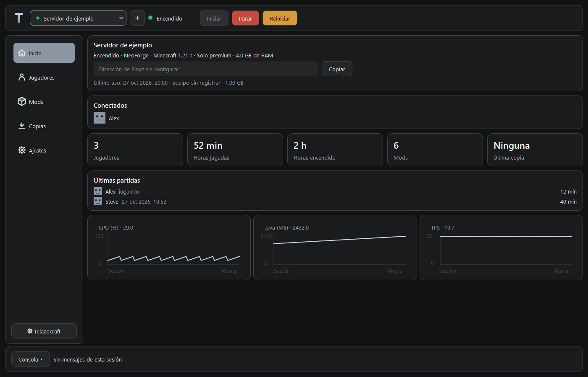
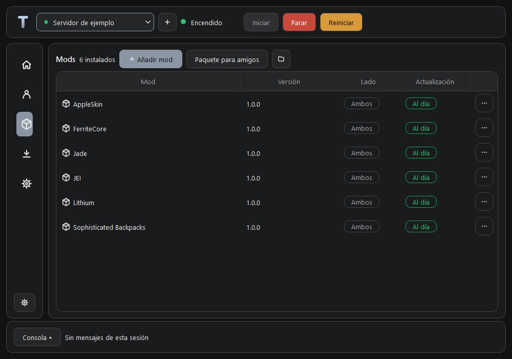

# Telazocraft 0.3.1

Gestor de bibliotecas de servidores Minecraft para Windows. Autor: Adrián Rodríguez Rodríguez.
Licencia MIT. En el equipo del autor la biblioteca vive en `biblioteca/`, dentro de esta carpeta,
pero está excluida de Git: el repositorio nunca contiene mundos, servidores, mods, jugadores,
copias ni claves.

Permite iniciar un solo servidor, enviar comandos, consultar jugadores, sesiones y rendimiento,
gestionar mods de Modrinth y generar un paquete completo para amigos. Incluye copias por niveles, restauración,
partidas hardcore con gracia frente a daño normal, bandeja y avisos. `/kill` ignora la gracia.



## Instalar y empezar

Descarga [Telazocraft para Windows](https://github.com/ItsRodryy/telazocraft/releases/latest).
El instalador funciona por usuario en Windows 10/11 de 64 bits e incluye Python y Qt.
Minecraft requiere su Java correspondiente (el asistente indica la versión y ofrece instalarlo).
Necesitas conexión para descargar servidores, mods y actualizaciones.

1. Abre Telazocraft y elige una biblioteca existente o una carpeta vacía.
2. En una biblioteca nueva puedes crear «Servidor de prueba»: última release vanilla, sin mods.
   Se descarga al aceptar; nunca se añade automáticamente a una biblioteca existente.
3. Usa ＋ para crear otro servidor. Elige versión, mods, mundo, acceso y acepta la EULA.
4. Pulsa Iniciar cuando quieras jugar. La aplicación nunca arranca un servidor al abrirse.

Playit es opcional: si tienes un agente configurado en `compartido/playit.exe`, la aplicación
lo usa; sin él puedes jugar por LAN o con tu conexión configurada. Syncthing también es opcional.

## Desarrollo

Python 3.11 o posterior. Desde esta carpeta, en PowerShell:

```powershell
python -m venv .venv
.venv/Scripts/python.exe -m pip install -r requirements.txt
$env:PYTHONPATH='code'
.venv/Scripts/python.exe -B -m telazocraft
```

En el primer arranque elige una biblioteca existente o una carpeta vacía para crearla. Las
preferencias de cada equipo viven en `%LOCALAPPDATA%/Telazocraft/ajustes.json`.
El modo de consola se abre con `python -m telazocraft --biblioteca RUTA --consola ID`.
`stop` guarda, detiene y crea copia de sesión; Ctrl+C solicita una parada segura.

## Uso

- El desplegable superior elige el servidor; el botón ＋ abre el asistente de cinco pasos. Al abrir nunca se inicia un servidor automáticamente.
- **Inicio**: conectados, partidas en curso y horas globales de jugadores y servidor. Las gráficas de CPU, RAM y TPS recogen datos desde el arranque y se dibujan al mostrar Inicio.
- **Jugadores**: Lista y Actividad. El historial se importa de logs comprimidos o normales sin duplicar sesiones; identidades antiguas se unen por nick. Permisos y acciones en «⋯».
- **Mods**: carga automática, iconos en caché y búsqueda mientras escribes, filtrada por Minecraft y loader. Marca los mods ya instalados. Admite JAR, dependencias y actualizaciones a petición. Cambios solo con el servidor parado.
- **Copias**: tarjetas por fecha y tipo; crear o restaurar con confirmación. El mundo sustituido y los ZIP rotados van a `archivo/`.
- **Ajustes**: General, Mundo (con Chunky), Acceso, Copias, Hardcore y Extras de cliente. Editar → cambios sin aplicar → confirmar antes/después. Cancelar conserva los datos.
- El engranaje **Telazocraft** abre una ventana con Playit, Syncthing, Java, biblioteca y actualizaciones.
- La **Consola** se despliega desde el borde inferior; recuerda apertura y altura. Admite búsqueda y comandos con historial. La barra lateral pasa a iconos por debajo de 1080 px.
- La X oculta en bandeja; «Salir» detiene y espera la copia. Iniciar no pide confirmación; Parar pregunta cuando hay jugadores conectados.

La gracia hardcore empieza con la primera entrada. Usa Resistencia y resistencia al fuego;
protege del daño normal, no de órdenes administrativas como `/kill` ni del vacío. Tras una muerte
fuera de la gracia se conserva la partida y se genera otra con una semilla diferente.

## Paquete para amigos

En Mods o en la bandeja, elige **Paquete para amigos**. Se crea en
`exportaciones/<id>/Paquete_<Nombre>_<fecha>.zip`: mods de cliente o ambos, extras compatibles,
instalador de NeoForge verificado, `Instalar.bat` y `LEEME.txt`. Vanilla no incluye NeoForge.
Se conservan tres paquetes; los anteriores pasan a `archivo/exportaciones/`.

Comparte el ZIP completo. Tu amigo debe descomprimirlo y ejecutar `Instalar.bat` con el juego
cerrado. Busca Java en PATH y en los runtimes de los launchers, aparta los mods anteriores y
prepara el cliente. Admite launcher oficial y TLauncher; ambos deben usar la versión y carpeta
indicadas en el LEEME. Si falla la instalación silenciosa, abre el instalador normal.
Para deshacerlo, cierra el juego, aparta los mods nuevos y recupera `mods_anterior_<fecha>`.



## Verificación

```powershell
$env:PYTHONPATH='code'
$env:QT_QPA_PLATFORM='offscreen'
.venv/Scripts/python.exe -B -m unittest discover -s tests
.venv/Scripts/python.exe -B -m telazocraft --biblioteca RUTA --smoke
```

Para pruebas reales locales usa `GESTOR_NO_PLAYIT=1`. Los datos de producción se conservan sin
editar; se prueba sobre una copia o sobre un servidor dedicado a pruebas. Las pruebas de interfaz
comprueban los controles reutilizados, contraste y dimensiones. Los tests de red usan HTTP simulado;
el instalador de cliente se comprueba con un APPDATA aislado. Ninguna prueba automática arranca
un servidor de producción. El log de la app vive en `%LOCALAPPDATA%/Telazocraft/telazocraft.log`.

## Instalador y Releases

`python tools/empaquetar.py --iscc RUTA_A_ISCC --repositorio ItsRodryy/telazocraft` fabrica `dist/Telazocraft-0.3.1-windows.exe` y
`SHA256SUMS`. Requiere Inno Setup 6.7 o posterior. Usa CPython 3.12.15 de python-build-standalone,
verificado con el SHA-256 de la publicación 20261001, dependencias dinámicas y código `.pyc`.
El instalador es por usuario, crea accesos «Telazocraft» y no incluye bibliotecas Minecraft.
El lanzador Windows se compila con el compilador .NET Framework incluido en Windows.

El flujo `.github/workflows/release.yml` compila y
publica al crear una etiqueta `vX.Y.Z`; `workflow_dispatch` solo genera el artefacto. Configura
`--repositorio propietario/telazocraft` al fabricar para que la instalación sepa de dónde actualizar;
GitHub Actions lo toma del repositorio actual. El repositorio público predeterminado es ItsRodryy/telazocraft.
No se presupone una URL ni se publica nada al ejecutar el programa. Las actualizaciones requieren
una Release estable con el instalador y un `digest` SHA-256 de GitHub; se verifican antes de ejecutar.

Las conexiones HTTPS usan el almacén de certificados del sistema mediante truststore. Las
licencias originales de Python, Qt y truststore acompañan al instalador.
